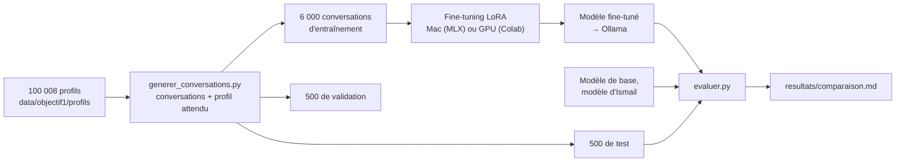

# Objectif 1 : petit modèle fine-tuné pour construire le profil de l'assuré

L'agent de recommandation doit d'abord comprendre **qui est le client**, à partir de la conversation. Ici, on apprend
à un **petit modèle de langage local** (0,5 à 1,5 milliard de paramètres) à lire la conversation conseiller ↔ client et à
en sortir le profil en JSON (28 champs : conducteur, permis, antécédents, véhicule, usage, couverture, budget).

Cette approche est comparée à celle d'Ismail (modèle sous Ollama, sans entraînement) sur le **même jeu de test**.

## Idée



Le profil attendu ne contient **que ce que le client a dit** : une information jamais donnée reste `null`. Le modèle apprend
ainsi à ne rien inventer, ce qu'on mesure à part (taux d'« inventions »).

## Les fichiers

| Fichier | Rôle |
| --- | --- |
| `schema.py` | Les 28 champs du profil et la consigne donnée au modèle (la même pour tous les modèles comparés) |
| `generer_conversations.py` | Crée les conversations à partir des profils, avec le profil attendu |
| `donnees/` | `train.jsonl` (6 000), `valid.jsonl` (500), `test.jsonl` (500) au format chat, et `test_conversations.jsonl` pour l'évaluation |
| `entrainer_mac.sh`, `lora_mac.yaml` | Fine-tuning LoRA sur Mac Apple Silicon avec MLX (réglages dans le YAML), puis fusion du modèle |
| `entrainer_gpu.py` | Même fine-tuning sur GPU NVIDIA (Google Colab, Kaggle) |
| `vers_ollama.sh` | Convertit le modèle fine-tuné en GGUF et le crée dans Ollama |
| `evaluer.py` | Mesure un modèle sur le jeu de test et compare tous les modèles évalués |

## Les conversations

Chaque profil donne une conversation de devis en français. Pour que le modèle généralise, elle varie :

- plusieurs formulations par question et par réponse, registre poli ou familier ;
- le client donne souvent plusieurs informations d'un coup au début (45 %) ;
- des réponses à convertir : « permis depuis 2015 » → 11 ans, « bonus de 50 % » → CRM 0.50, « dans la rue » → voie_publique ;
- des corrections (« ah non pardon, 12 000 »), des « je ne sais pas », des questions oubliées par le conseiller ;
- 20 % de conversations coupées en cours de route : le profil est alors partiel ;
- des clients de 20 pays européens, avec des permis du monde entier, et le bonus-malus de chaque pays
  (classe di merito, SF-Klasse, degré belge, no claims bonus…).

Exemple (extrait) :

```
Conseiller : Bonjour, bienvenue. Faisons votre devis ensemble. Parlez-moi un peu de votre besoin.
Client : Salut, alors voilà : à Meslan, B, depuis 11 ans, je m'en sers pour mon métier, déplacements pro, ma voiture, une Renault Espace, c'est une hybride.
Conseiller : Merci. Quelle est sa date de première mise en circulation ?
Client : Première mise en circulation en 2019.
Conseiller : Super. Dans quel pays avez-vous obtenu votre permis ?
Client : En Chine, il est reconnu ici.
```

Limite à dire dans le rapport : les conversations sont construites à partir de modèles de phrases, pas écrites par de
vrais clients. Le modèle risque d'être meilleur sur ces conversations que sur de vraies. Pour le vérifier, on peut ajouter
au jeu de test quelques conversations écrites à la main, ou jouées par un gros LLM dans le rôle du client.

## Lancer le fine-tuning

### Sur Mac (Apple Silicon, 16 Go conseillés)

Depuis la racine du dépôt :

```bash
# essai rapide (petit modèle, ~20 min)
bash objectif1/agent_profil_slm/entrainer_mac.sh Qwen/Qwen2.5-0.5B-Instruct 300

# entraînement complet (1 passage sur les 6 000 conversations)
bash objectif1/agent_profil_slm/entrainer_mac.sh Qwen/Qwen2.5-1.5B-Instruct 1500
```

Le modèle de base est téléchargé depuis Hugging Face au premier lancement. Le résultat est dans
`objectif1/agent_profil_slm/modeles/<modele>/fusionne` (ce dossier n'est pas envoyé sur GitHub, il est trop gros).

### Sur Google Colab (GPU T4 gratuit)

```python
!git clone https://github.com/adam-hassen/assuria-projet.git
%cd assuria-projet
!pip install -q "transformers>=4.45" "peft>=0.13" accelerate datasets
!python objectif1/agent_profil_slm/entrainer_gpu.py --modele Qwen/Qwen2.5-1.5B-Instruct
```

Réglages communs aux deux : LoRA, taux d'apprentissage 1e-4, lots de 4, 1 passage, conversations jusqu'à 2 048 jetons,
perte calculée uniquement sur la réponse JSON.

### Mettre le modèle dans Ollama

```bash
bash objectif1/agent_profil_slm/vers_ollama.sh objectif1/agent_profil_slm/modeles/qwen2.5-1.5b-instruct/fusionne assuria-profil
ollama run assuria-profil
```

## Évaluer et comparer

Tous les modèles reçoivent la même consigne et les mêmes 500 conversations de test.

```bash
# modèle de base, sans entraînement (point de départ)
ollama pull qwen2.5:1.5b
python3 objectif1/agent_profil_slm/evaluer.py --backend ollama --modele qwen2.5:1.5b --nom qwen1.5b-base

# modèle fine-tuné
python3 objectif1/agent_profil_slm/evaluer.py --backend ollama --modele assuria-profil --nom qwen1.5b-finetune

# modèle d'Ismail (n'importe quel modèle Ollama)
python3 objectif1/agent_profil_slm/evaluer.py --backend ollama --modele <son_modele> --nom ismail

# tableau de comparaison
python3 objectif1/agent_profil_slm/evaluer.py --comparer
```

Ajouter `--n 50` pour un essai rapide sur 50 conversations.

| Mesure | Sens |
| --- | --- |
| JSON valide | Part des réponses qui sont un JSON lisible |
| Exactitude | Part des informations données que le modèle a bien remplies |
| Oublis | Part des informations données que le modèle a laissées vides |
| Inventions | Part des champs jamais donnés que le modèle a remplis quand même (hallucination) |
| Profils parfaits | Part des conversations où tout le profil est juste |
| Latence, jetons/s | Rapidité sur la machine utilisée (à comparer sur la même machine) |

Les résultats vont dans `resultats/<nom>/` : `resume.json`, `par_champ.csv` (exactitude champ par champ) et `reponses.jsonl`
(toutes les réponses, pour regarder les erreurs).

Pour que la comparaison avec Ismail soit juste : même machine pour la latence, et la même consigne (`schema.py`). Si son
agent construit le profil tour par tour pendant la conversation, on peut aussi lui donner la conversation complète à la
fin, comme ici : c'est ce qui est mesuré.

## Régénérer les données

```bash
python3 objectif1/agent_profil_slm/generer_conversations.py
```

Graine fixe : les mêmes conversations à chaque fois.
